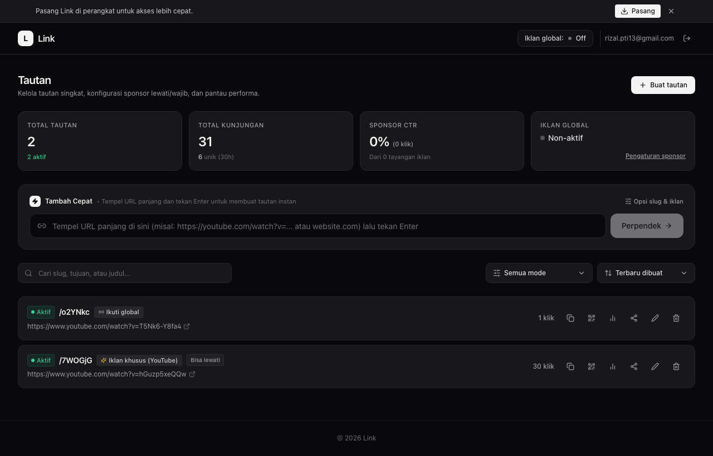

# Link

Pemendek tautan modern dengan monetisasi iklan foto & video YouTube, kontrol lewati/wajib tonton, laporan sponsor publik, proteksi PIN, dynamic QR code, dan analitik lengkap yang berjalan 100% di Cloudflare Free Tier (Rp 0 server cost).

[](https://react.dev)
[](https://www.typescriptlang.org)
[](https://hono.dev)
[](https://tailwindcss.com)
[](https://developers.cloudflare.com/workers/)
[](https://developer.mozilla.org/en-US/docs/Web/Progressive_web_apps)
[](./LICENSE)
[](https://link.solusikoding.com)

---

## Pratinjau Aplikasi



---

## Fitur Utama

- ⚡ **Tambah Cepat (*Instant Shorten*):** Cukup tempel URL panjang di dashboard dan tekan **Enter** — tautan langsung jadi dan otomatis tersalin ke *clipboard* dalam hitungan milidetik.
- 💰 **Monetisasi Sponsor Pintar:** Sisipkan iklan foto atau video YouTube perantara sebelum pengunjung dialihkan, lengkap dengan tombol Call-to-Action sponsor.
- ⏱️ **Kontrol Lewati & Wajib Tonton:** Atur apakah iklan bisa dilewati setelah hitung mundur (*skippable*) atau wajib ditonton sampai selesai (*forced*), serta opsi otomatis *redirect*.
- 📊 **Laporan Sponsor Publik:** Bagikan tautan laporan analitik *read-only* (`/report/:token`) langsung kepada klien atau pengiklan tanpa perlu login ke dashboard.
- 🔒 **Proteksi Sandi & Batas Waktu:** Kunci tautan dengan PIN rahasia, pasang batas tanggal kedaluwarsa (WIB), atau batasi kuota maksimal klik.
- 📱 **Dynamic QR Code Siap Cetak:** Unduh kode QR dinamis beresolusi tinggi dalam format vektor SVG murni atau PNG dengan pilihan palet warna kustom.
- 🇮🇩 **Analitik Bersih & Lokal Indonesia:** Deteksi wilayah provinsi, ISP lokal (Telkomsel, Indihome, Indosat, XL, dll.), serta filter bot scraper WhatsApp/Medsos agar analitik tidak membengkak palsu.
- 🖥️ **Desain Responsif Multi-Seksi:** Tampilan dashboard rapi yang otomatis beradaptasi ke mode multi-kolom di monitor lebar (*widescreen*) tanpa scroll vertikal yang melelahkan.
- ☁️ **100% Cloudflare Free Tier:** Berjalan penuh di atas Cloudflare Workers, D1 Database, dan KV Cache dengan biaya server Rp 0.

---

## Dokumentasi Lengkap

Detail teknis dan panduan lanjutan dapat dipelajari di folder `docs/`:

| Dokumen | Deskripsi |
|---|---|
| [📖 Fitur Lengkap](./docs/features.md) | Penjelasan detail seluruh fitur, alur kerja, dan opsi konfigurasi |
| [🚀 Panduan Memulai](./docs/getting-started.md) | Panduan instalasi dan menjalankan aplikasi di komputer lokal |
| [☁️ Panduan Deployment](./docs/deployment.md) | Langkah-langkah deploy ke Cloudflare Workers, D1, KV, dan custom domain |
| [🏗️ Arsitektur Teknis](./docs/architecture.md) | Diagram alur, sistem caching sub-15ms, dan skema database |

---

## Mulai Cepat di Lokal

```bash
# 1. Clone repository
git clone https://github.com/rizalahmaddd/link.git
cd link

# 2. Install dependensi
npm install

# 3. Migrasi database D1 lokal & build
npm run db:migrate:local
npm run build

# 4. Jalankan server lokal
npx wrangler dev --port 8799
```

Buka **[http://localhost:8799](http://localhost:8799)** di browser Anda.

---

## Lisensi

Dirilis di bawah [Lisensi MIT](./LICENSE). Dibuat oleh [@rizalahmaddd](https://github.com/rizalahmaddd) &bull; [solusikoding.com](https://solusikoding.com).
